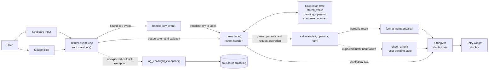
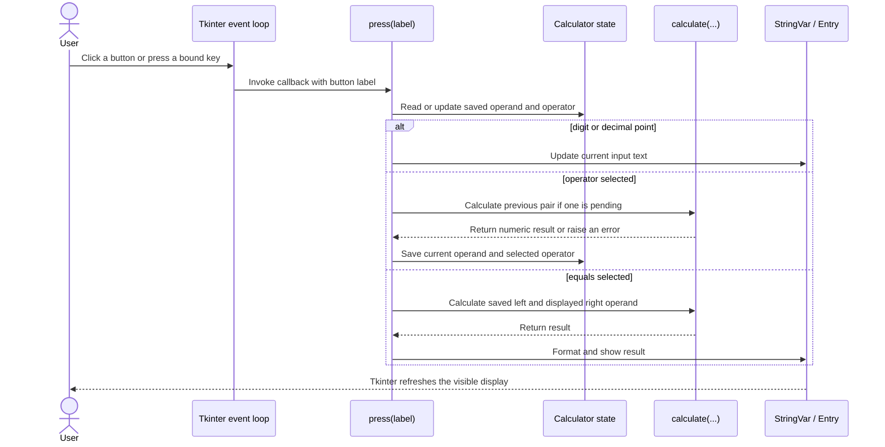

# Python Calculator Architecture

This diagram shows the main runtime components and how input becomes a displayed result. It is an architecture/UML-style view; the code uses functions and Tkinter objects rather than a custom class hierarchy.

## Interaction sequence

The `calculate` function is independent of Tkinter, allowing headless tests to exercise arithmetic without creating a GUI. Expected calculation failures are caught by the event handler and shown as `Error`; unexpected callback failures are written to the crash log.
